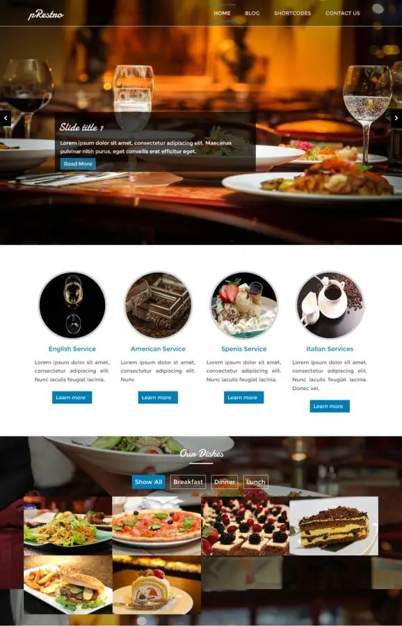
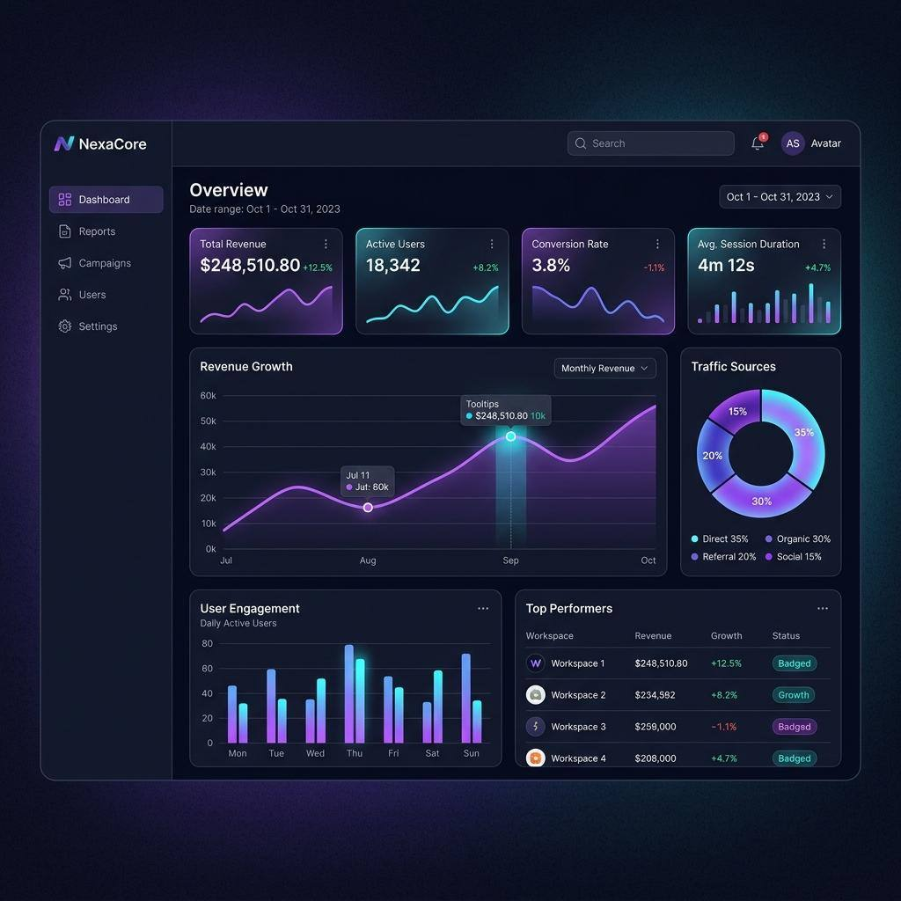
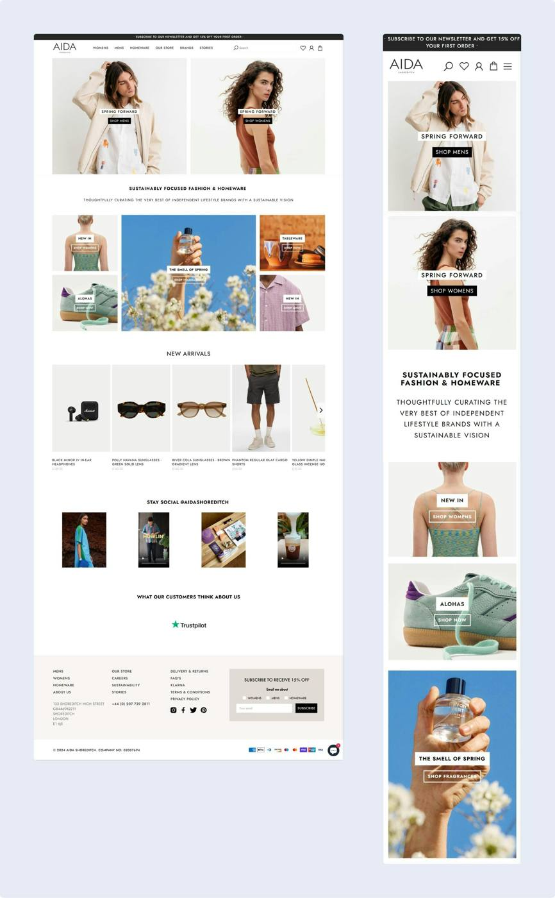
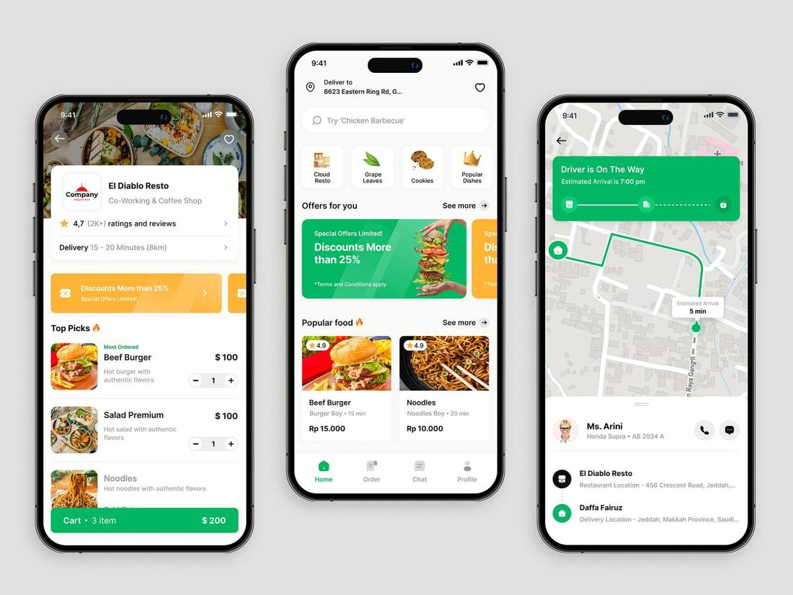
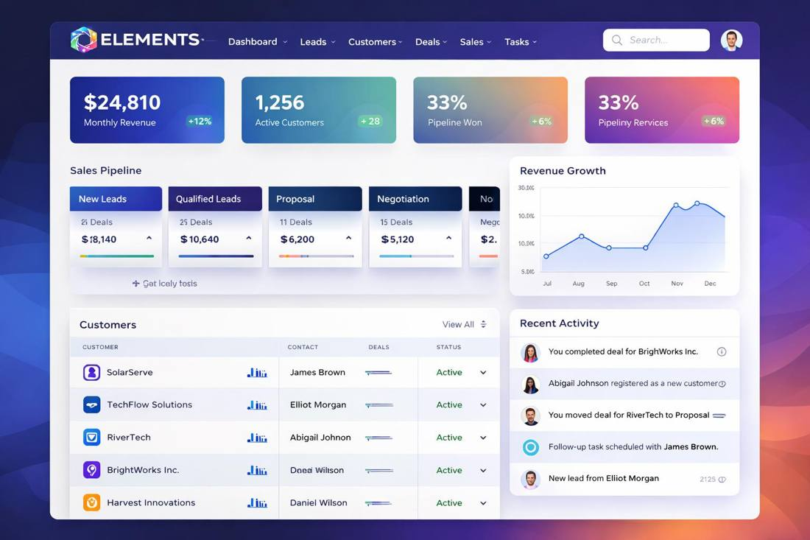
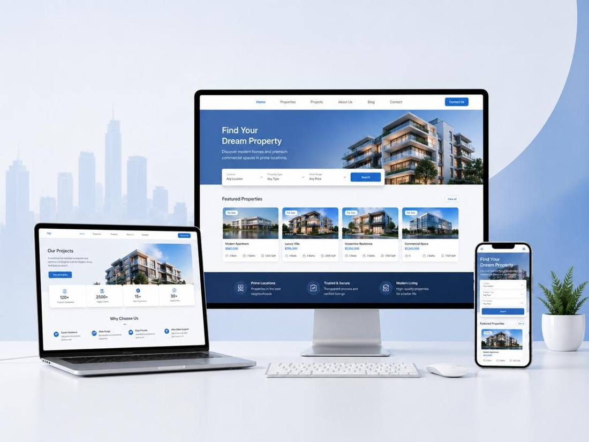

  

<h1 align="center">Anderson T. M. L.</h1>

  <strong>Senior Full Stack &amp; Android Developer</strong> 
  Brazil · Platinum on Workana

  
  
  
  

  
  
  

---

## About

I am a Full Stack and Android Developer with many years of experience building scalable web applications, Android mobile apps, and cloud-based systems for startups, SMEs, and enterprise clients across Brazil. I specialize in secure, high-performance solutions that combine modern frontend technologies with robust backend architectures and native Android development.

My expertise includes React, Next.js, Vue.js, Node.js, Laravel, Java Spring Boot, Kotlin, Java, Firebase, PostgreSQL, MySQL, MongoDB, Docker, and AWS. I have worked on e-commerce platforms, business management systems, fintech applications, CRM solutions, booking systems, and custom Android applications from concept to production.

I focus on clean architecture, maintainable code, strong communication, and delivering reliable software that supports long-term business growth.

### Português

Sou desenvolvedor Full Stack e Android com muitos anos de experiência na criação de aplicações web escaláveis, aplicativos móveis Android e sistemas em nuvem para startups, PMEs e grandes empresas em todo o Brasil. Sou especializado no desenvolvimento de soluções seguras e de alto desempenho que combinam tecnologias modernas de front-end com arquiteturas robustas de back-end e desenvolvimento nativo para Android.

Minha expertise inclui React, Next.js, Vue.js, Node.js, Laravel, Java Spring Boot, Kotlin, Java, Firebase, PostgreSQL, MySQL, MongoDB, Docker e AWS. Trabalhei em plataformas de e-commerce, sistemas de gestão empresarial, aplicações fintech, soluções CRM, sistemas de reservas e aplicativos Android personalizados, desde a concepção até a produção.

Meu foco é em arquitetura limpa, código de fácil manutenção, comunicação eficaz e entrega de software confiável que suporte o crescimento dos negócios a longo prazo.

Languages: **Portuguese** and **English**, both native or bilingual. Rate on Workana: **USD 19 / hour**.

---

## Selected work

Screenshots from the portfolio published on Workana.

### pRestro restaurant theme

Restaurant homepage with a hero, service sections, and a dish gallery.

### AI SaaS business analytics

NexaCore dashboard for revenue, active users, conversion, and traffic.

### Shopify e-commerce store

AIDA fashion and homeware store, laid out for desktop and phone.

### Food delivery mobile app

Menu, offers, and live driver tracking.

### CRM and sales system

ELEMENTS pipeline for leads, customers, deals, and recent activity.

### Real estate platform

Property search that stays readable on laptop, desktop, and phone.

---

## Skills

Years and project counts are the ones listed on Workana.

Also on the profile:

### Certifications

| Score | Test |
| --- | --- |
| 96% | Android advanced |
| 93% | CSS basics |
| 83% | Android intermediate |
| 80% | WordPress advanced |
| 80% | English |

---

## Clients

Five clients hired me more than once. Current role: Senior Full Stack & Android Developer on Workana, since August 2026.

> O Anderson foi um profissional excepcional do início ao fim. Além de entregar um site extremamente rápido, seguro (LGPD) e otimizado para o Google Ads, ele demonstrou uma sensibilidade ímpar com as normas éticas do Conselho Federal de Psicologia (CFP). Conseguiu traduzir com perfeição o tom acolhedor e sênior que o meu consultório online precisava.

**L. C. G. D. O.** · 5.0 · WordPress landing page for a psychology practice

> Anderson é prestativo, inteligente e faz um bom trabalho!

**Amanda I.** · 5.0 · Construction SaaS with AI

---

## Contact

- Email: [raymond.r0427@gmail.com](mailto:raymond.r0427@gmail.com)
- Workana: [Anderson T. M. L.](https://www.workana.com/freelancer/df0b163e934eb86741879c330928cd44)
- GitHub: [Anderson10213](https://github.com/Anderson10213)
